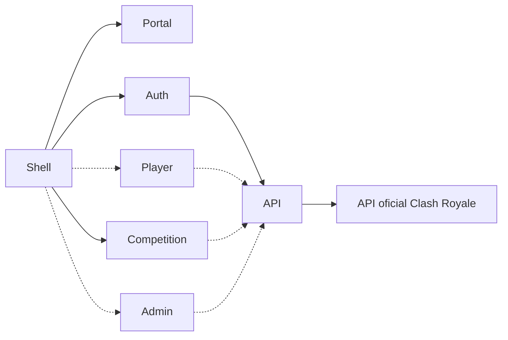

# Migração para o monorepo

## Projetos de origem

| Projeto           | Implementação encontrada                                                         | Responsabilidades                                                                                      |
| ----------------- | -------------------------------------------------------------------------------- | ------------------------------------------------------------------------------------------------------ |
| `clash-cup-site`  | PHP, MySQL, jQuery e CSS de template                                             | Início, torneios, ranking, regras, contato, apoiadores e políticas                                     |
| `api-clashroyale` | Node.js, Express e Axios                                                         | Consulta de jogadores, próximos baús e detalhes de torneios                                            |
| `site-login`      | React 18, Vite, JavaScript/TypeScript, Firebase, Material UI e styled-components | Login, cadastro, vínculo da tag, torneios, inscrições, ranking, perfil, área VIP, loja e administração |

As rotas React atuais são `/`, `/signup`, `/registerIdClashRoyale`, `/dashboard`, `/torneio` e `/ranking`. Dentro do dashboard, o menu alterna as funcionalidades. Parte delas ainda não tem endereço próprio.

O login usa Google com Firebase Authentication. Há também uma implementação de cadastro por email/senha. As coleções acessadas incluem `users`, `admins`, `tournament`, `myTournament`, `ranking`, `rankingHistory` e `shop`.

O site PHP consulta tabelas MySQL, enquanto a aplicação React consulta Firestore. **As duas fontes não devem ser consideradas sincronizadas.** Antes de importar registros, é necessário definir a origem oficial para torneios e ranking, identificar duplicidades e mapear os identificadores existentes. O dump SQL não deve ser copiado para o novo repositório.

## Divisão planejada

| Aplicação     | Escopo                                                                  | Situação                                              |
| ------------- | ----------------------------------------------------------------------- | ----------------------------------------------------- |
| `shell`       | Layout, navegação, rotas, carregamento e recuperação dos remotos        | Base implementada                                     |
| `portal`      | Conteúdo público: apresentação, regras, contato, apoiadores e políticas | Apresentação inicial implementada                     |
| `auth`        | Login, cadastro, saída e vínculo inicial com jogador                    | Base implementada                                     |
| `competition` | Torneios, inscrições, meus torneios e ranking                           | Torneios e inscrições implementados; ranking pendente |
| `player`      | Perfil, baús, área VIP, loja e emblemas                                 | Planejada                                             |
| `admin`       | Administração de torneios, ranking e permissões                         | Planejada                                             |
| `api`         | Adaptador para a API oficial e futuras operações de negócio autorizadas | Adaptador inicial implementado                        |

Os limites seguem responsabilidades de produto. A API é backend; ela não é um microfrontend. Os pacotes compartilhados devem conter contratos, infraestrutura e elementos reutilizáveis, evitando importar telas ou regras de uma aplicação diretamente em outra.

As ligações tracejadas representam integrações ainda não implementadas.

## Plano por etapas

1. **Fundação:** npm workspaces, TypeScript, React, styled-components, Module Federation, shell, apresentação pública inicial, API com Axios/Zod e testes da integração. Sem credenciais copiadas do legado.
2. **Autenticação:** pacote compartilhado para sessão Firebase, estados de carregamento, Google, cadastro e vínculo da tag. Adicionar o remoto `auth`, rotas acessíveis por URL e testes com ambiente de desenvolvimento isolado. Google e email/senha foram mantidos. Detalhes em [Autenticação](authentication.md).
3. **Competições (implementada):** remoto `competition`, listas de torneios, detalhes, inscrições e meus torneios. Preservar campos e identificadores existentes; controlar concorrência de vagas com operações atômicas. Revisar dados MySQL/Firestore antes de qualquer importação. Inscrições antigas permanecem somente leitura até revisão dos identificadores; detalhes e regras em [Competições](competitions.md).
4. **Área do jogador:** remoto `player`, perfil, baús e área VIP. Integrar a API pelo mesmo domínio e cancelar consultas substituídas. Adicionar cache somente onde a política de validade estiver definida.
5. **Loja e ranking:** saldo, emblemas, histórico e ranking. Validar saldo e propriedade no backend/regras do banco; transferências e débitos precisam ser atômicos. Importações de resultados devem ser idempotentes para evitar pontuação duplicada.
6. **Administração:** remoto `admin`, gestão de torneios, ranking e administradores. Validar identidade e permissões nas operações de dados; ocultar menus no frontend não concede nem revoga autorização. Remover o fallback por email fixo presente no legado.
7. **Conteúdo público e acabamento:** migrar regras, políticas, contato e apoiadores; confirmar os destinos atuais dos links; revisar responsividade, acessibilidade e identidade visual. Formulários só devem aparecer como funcionais quando houver tratamento de envio.
8. **Entrega:** testes completos, CI, documentação, configuração de produção e Docker. Validar a execução a partir de uma cópia limpa e conferir a conectividade real da API oficial no ambiente escolhido.

Cada etapa termina com verificações e um conjunto de alterações para revisão e commit antes da próxima.

## Contratos e estado

- Shell e remotos compartilham React, React DOM, React Router e styled-components como singletons.
- Cada remoto oferece conteúdo federado e inicialização independente. O conteúdo federado não cria um segundo roteador.
- A sessão deve ter uma única fonte de verdade compartilhada; cada remoto não deve inicializar uma sessão Firebase diferente.
- Firebase Authentication e Firestore serão preservados inicialmente. Trocar a arquitetura de frontend não exige trocar o banco.
- A etapa 2 adiciona o pacote `session`, novos vínculos por UID e regras de transição para a coleção `playerProfiles`. A leitura de vínculos antigos por email confirmado não altera os documentos do legado. Veja [Autenticação](authentication.md) para configuração, limites dos testes e permissões de transição nas coleções antigas. A etapa 3 restringe torneios e inscrições e adiciona um gateway Firebase compartilhado.
- A API mantém os três caminhos anteriores, valida a entrada e a estrutura mínima da resposta e preserva campos adicionais consumidos no legado.
- As credenciais vêm do ambiente. A configuração pública do Firebase e os segredos do backend devem ter fluxos distintos.

## Critérios da primeira etapa

- Instalar as dependências na raiz e iniciar shell, portal e API com um comando.
- Executar o portal também de forma independente.
- Abrir a página inicial e navegar para Sobre sem depender de Firebase.
- Mostrar erro recuperável quando o portal estiver indisponível, mantendo a navegação do shell.
- Preservar a referência recuperada ao sair da página inicial e voltar.
- Verificar tags, métodos HTTP, erros externos e respostas incompatíveis sem chamar a API real nos testes.
- Gerar builds separados e executar a prévia local.

Os testes locais não comprovam a validade do token nem a configuração da conta na API oficial. A verificação real será feita com as credenciais locais no ambiente de integração, sem incluí-las no repositório.
